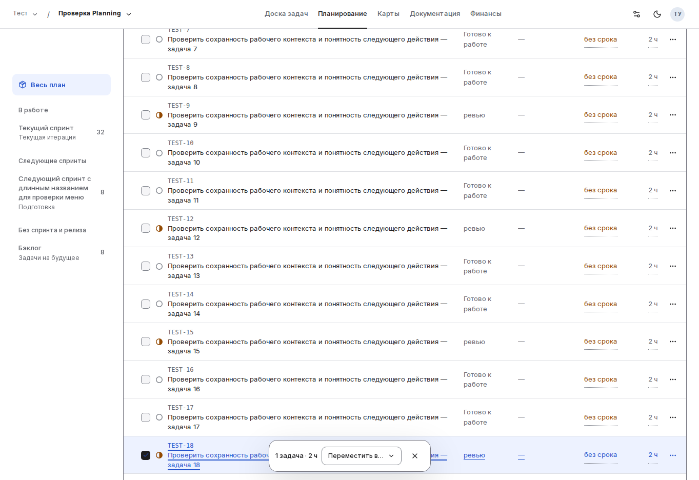
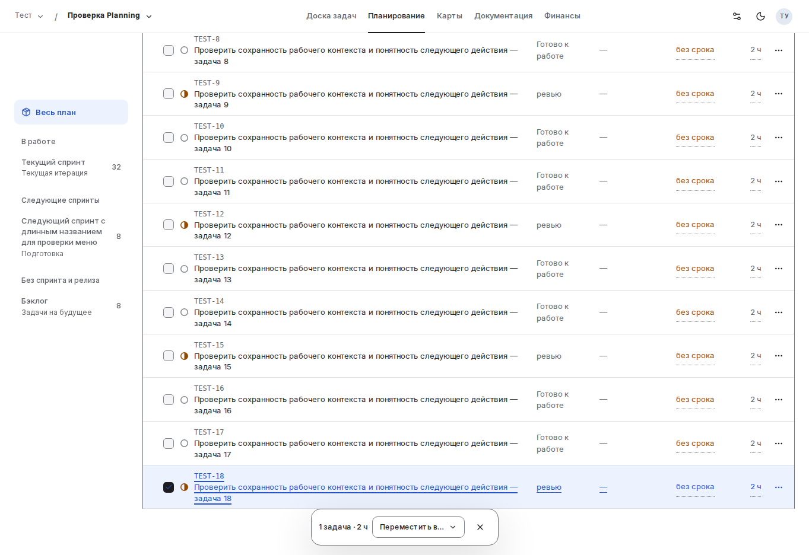
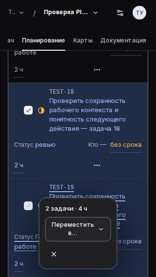
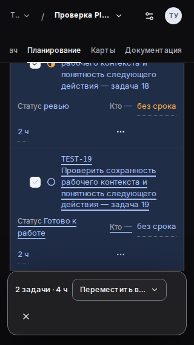
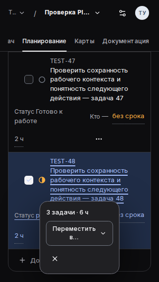
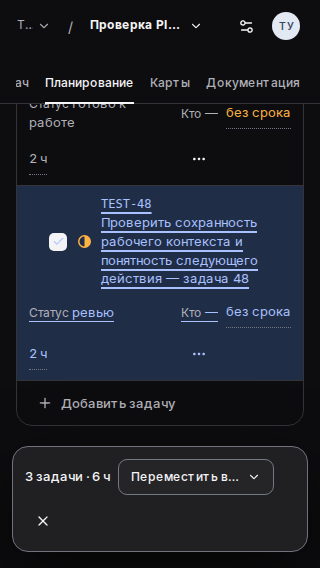

# Planning: фактическая браузерная проверка 38211016913

**Candidate frontend regression — PASS; historical baseline — ожидаемый FAIL, распознанный отдельным proof.** В этом пакете сохранены оба исходных `results.json` и шесть выбранных PNG без изменения bytes, обрезки или пересжатия. Они сохраняют ключевое доказательство после истечения срока временного GitHub Actions artifact. Остальные профили и состояния полностью представлены в JSON; изображения здесь намеренно выбраны для трёх подтверждённых сценариев.

Независимый [R3](../../reviews/R3.md) подтвердил исправление F2 и дал **scoped approve** геометрии и затронутого frontend поведения. Полный независимый отчёт сохранён [дословно](../../reviews/evidence/independent-R3.md). Этот пакет — копия исходной browser evidence, а не новый запуск или саморевью, заменяющее R3.

## Источник и точная поставка

| Поле | Значение |
| --- | --- |
| CI | [Run 38211016913 / job 114684962493](https://github.com/it-novikov/iquipage-design-system/actions/runs/38211016913/job/114684962493) |
| Исходный artifact | `planning-browser-evidence`, id `11729218842`, 1,959,278 bytes; полный ZIP здесь не дублируется |
| SHA256 исходного ZIP | `841818ca69bb413c86f5ee3bb6bd6e5dc11c4bc4c124defd025c50b5155d2ee5` |
| Immutable baseline | `f5f941afa4e9be8a709e6de67a92bacf5a9397ca` |
| Проверенный опубликованный head | `b6fb06461dd0b391ac24b4ea0772e92f67c0f1cc` |
| Actual candidate sourceRevision из JSON | `bb58e47e952c0dc7dd19248abcc67c86c85053d9` |
| Общий tree head и CI merge | `9ac5da101814249754649b2d8591534f7685fb85`, сверено через Git |
| DS | `@iquipage/web` `0.6.0-vnext.52` |
| SHA256 DS archive | `989fab4822db78e10bfeeb62ad2724d8bb389a08ddf012c196b469af33cde758` |
| SHA256 baseline Planning CSS | `abc64121cac705d4cb6a7a183cc79e2bb0e3e5992e01a0f3483eaff0ff0b7f1a` |
| SHA256 candidate Planning CSS | `0916a36d4a682ce7b05e84fc8732382ce4bbda03b707578ffd909dc16b6650f4` |
| Runtime CI | Chromium `151.0.7922.34`, Node `v24.20.0` |
| Профили | 1363×936 light/comfortable; 1280×720 light/compact; 320×568 dark/comfortable; deviceScaleFactor 1 |

Идентичность сохранённых файлов исходным проверена побайтово; SHA256 ZIP дополнительно сверена с исходным пакетом. JSON не отредактированы: baseline сохраняет ожидаемые geometry failures, candidate сохраняет фактический PASS. Предыдущие красные CI-результаты не переименованы в успешные.

## Что подтверждено

На всех четырёх проверяемых candidate states каждого из трёх профилей (`selection`, `menuReturn`, `lastRow`, `return`) `visibleIntersection` строго равен **0**. Centre и lower-edge hit tests проходят; один реально прокручиваемый предок — workspace, `outerScrollTop=0`, document/horizontal overflow отсутствуют. `geometryFailures`, `interactionFailures`, `pageErrors`, `externalRequests` кандидата пусты.

Space/range selection/M/Escape, последний ряд, возврат из реального product dialog wrapper, scroll/focus, существующий DS drag edge-scroll/cancel и один recorded move intent в каждом профиле прошли. После скрытия bar workspace возвращает исходную высоту 880 / 664 / 464 px. Эти данные находятся в неизменённых JSON ниже.

| Состояние | Baseline visible area, CSS px² | Candidate raw area, CSS px² | Candidate visible area, CSS px² | Candidate centre / lower-edge hit |
| --- | ---: | ---: | ---: | --- |
| Desktop selected middle row | 19592 | 118.5 | 0 | true / true |
| Narrow после M → Escape | 23682.09375 | 62.5625 | 0 | true / true |
| Narrow selected last row | 15677.375 | 0 | 0 | true / true |

Raw-прямоугольники намеренно сохранены. Desktop row.bottom 858.375 обрезается workspace на 858; narrow menuReturn row.bottom 446.21875 обрезается на 446, где начинается bar. Их невидимые хвосты дают ненулевую raw area, но не видимое перекрытие. В narrow после Escape сохранены `activeRow=task-19` и lower-edge hit point `(160, 445)`. Clip задаётся измеренными CSS-предками (`clip` → `auto` → `hidden`), а не положением самой панели; trace и insets доступны в JSON.

## Выбранные исходные кадры до и после

Каждая пара показывает одно и то же действие на тех же synthetic данных. Полный кадр открывается по ссылке; PNG не редактировались.

| Сценарий | Baseline | Candidate |
| --- | --- | --- |
| Desktop: выбранная средняя строка |  |  |
| Narrow: состояние после закрытия меню клавишей Escape |  |  |
| Narrow: последняя выбранная строка |  |  |

## Файлы и контрольные суммы

SHA256 относится к полным исходным bytes каждого сохранённого файла.

| Файл | Bytes | SHA256 |
| --- | ---: | --- |
| [baseline/results.json](baseline/results.json) | 77,123 | `1e48e51d02fefcd706b86dd8bf47dfed8ecb80b22ebfc2a8345c2f0df442f217` |
| [baseline/desktop-selection.png](baseline/desktop-selection.png) | 130,791 | `666f5b9dd8b22df89471c53249ecf06fa32d2c7d369a0adefd99e04f9d5d9f84` |
| [baseline/narrow-menu-return.png](baseline/narrow-menu-return.png) | 36,232 | `61dad6822623bc90afbc4535b834cf13dd5f7cf7ef75e9bbf69da7a307149b02` |
| [baseline/narrow-last-row.png](baseline/narrow-last-row.png) | 38,790 | `0cfac710da5eb8a4d7c0ef7d58c6414d12d51d0612f3a6e2c04728533998c256` |
| [candidate/results.json](candidate/results.json) | 85,901 | `a626a1c0a841d8392ab6f7109c6141126dfa53ca2cef6e0e77b86bf7d554f177` |
| [candidate/desktop-selection.png](candidate/desktop-selection.png) | 123,525 | `f30caa93a7b3233b230715c09338577238a0ae8a419783cc00bf091343cbc787` |
| [candidate/narrow-menu-return.png](candidate/narrow-menu-return.png) | 29,989 | `2342d51e1b96d6f9e88c136e0859f74a39b3de362ef71c7023854cfd1f7dcf20` |
| [candidate/narrow-last-row.png](candidate/narrow-last-row.png) | 27,880 | `8576403e4f1a4548ba2c624693c9ac29962e75f8e0b4feaeed2112371d748959` |

## Граница приёмки и оставшиеся gates

Fixture монтирует настоящий `mountPlanning`, project navigation, product dialog wrapper, штатные product styles и точный public DS package. Данные вымышлены; adapter и Task content подменены. Команда перемещения записывает intent и явно отклоняется на synthetic boundary: успешное серверное сохранение не имитируется. Реальные пользовательские тексты, снимки авторизованного production, credentials и tokens сюда не включены.

S2 и A1/A2 принимаются только в согласованном объёме frontend геометрии и затронутых взаимодействий. Полный Task route, persistence/reload, F03 recovery, другие engines, реальный touch/AT/browser UI zoom и release suite этой проверкой не закрываются. Прежний focus на BODY после удаления clear-selection button остаётся записанной границей, не новым одобренным accessibility-контрактом.

На момент независимого R3 (**2026-10-12 06:15:21 UTC**) общий шаг `Library, product, real services and detached extraction` ещё выполнялся, последующие certificate/image/final-artifact gates не завершились. Общий workflow PASS, merge/release readiness и S3 этим пакетом **не объявлены**. Их завершение требует отдельного фактического результата.
