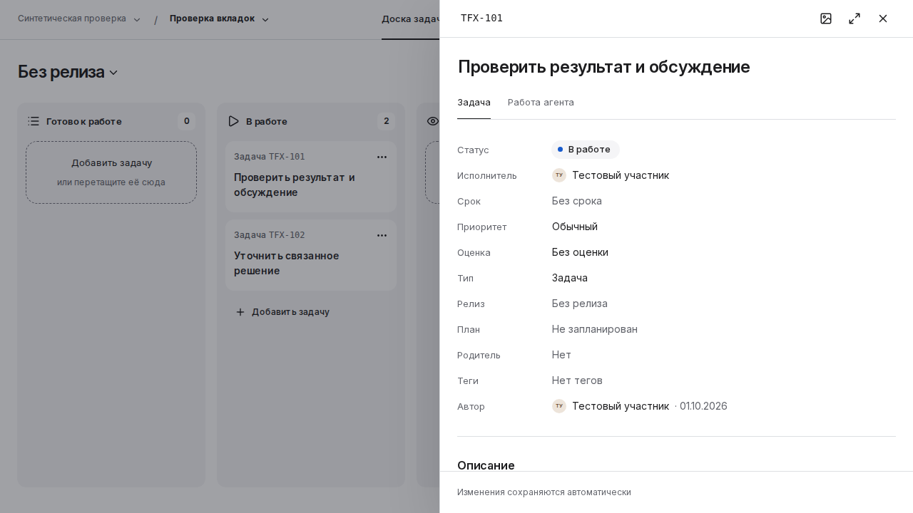

# Sprintique и IQUIPAGE: реализация плана и проверенные результаты

## 1. Главное

**Количественный лимит PR снят.** Число открытых PR, глубина стека и количество задач в `review` больше не служат причиной остановки. Работа сохраняется небольшими обозримыми изменениями с явными зависимостями. Решение закреплено в уже принятом [PR74](https://github.com/it-novikov/iquipage-design-system/pull/74); требования к качеству и независимому ревью сохраняются.

По problem-first плану уже подготовлены и приняты исправления контекста Task поверх Maps, панели массовых действий Planning, общих вкладок DS и обязательности дат спринта. Их собственные проверки и ограничения сохранены ниже. Они дают проверенную основу для следующего UX-среза; весь интерфейс Sprintique ещё требует последовательной проработки.

**Редактор оценки исправлен и принят в PR83.** Проверка окончательного варианта отдельно подтвердила десять сценариев открытия, фокуса, Escape и жизненного цикла, сопутствующие Tabs/Maps и полный CI. Новый пакет [native](native/estimate/current-4ff/README.md) и [полного CI](ci/estimate/current-4ff/README.md) относится к точному окончательному исходнику, а ранние попытки сохранены рядом. Сборка продукта и отдельной извлечённой копии прошли; запуск опубликованного продукта этим не проверялся.

**Обзор задачи восстановлен и проверен в PR88.** Пользователь снова видит начало результата и подходящий следующий шаг; вопрос без права ответа не выдаёт недоступную команду за доступную. [Независимое native R2](native/task-overview-recovery/README.md) принимает этот ограниченный объём: пять сценариев прошли, два длинных состояния сняты для анализа композиции. [Полный повторный прогон](ci/task-overview-recovery/attempt-2/README.md) завершил все восемь проверок: 478 тестов библиотеки, 610 product и 610 detached в JavaScript runner. [Первая попытка](ci/task-overview-recovery/attempt-1/README.md), остановившаяся на HTTP 504 загрузки Gradle, сохранена отдельно.

Параллельный [PR89](https://github.com/it-novikov/iquipage-design-system/pull/89) уже восстановил VT1 в `main`, а [PR90](https://github.com/it-novikov/iquipage-design-system/pull/90) переносит компактный вариант. Поэтому следующий шаг — адресная проверка актуальной компактной сводки и перенос необходимых регрессионных сценариев. Перенос всего старого runtime PR88 поверх PR90 откатил бы часть новых изменений. Прежние [сравнения Compact](task-first-screen/prototype/README.md) остаются отдельным экспериментальным свидетельством: их размеры и выигрыш не присваиваются новому исходнику автоматически.

**Главные открытые UX-задачи Task:** обеспечить полезный первый экран при длинном названии и результате; различить состояние запуска, шага и проверки результата; объяснить причину недоступности ответа. Общий переход «Открыть работу» требует отдельного сценария клавиатуры: записанный BODY focus сам по себе не доказывает, что навигация сломана. Эти вопросы не закрываются зелёным функциональным CI.

**Свойства исправляются на уровне дизайн-системы.** [Публичный DS54 baseline](property-list/README.md) воспроизвёл потерю подписей, обрезку выбранных значений и слишком тесные строки статического текста. В [PR91](https://github.com/it-novikov/iquipage-design-system/pull/91) подготовлена отдельная private56 поставка с переносом и естественной высотой. Два замечания source R1 к документации и применимости временного CI исправлены и независимо проверены. Продукт пока использует DS54.

Автоматическое парное сравнение DS54/56 прошло, однако визуальная приёмка A остаётся открытой. Реальные кадры подтверждают лучшее чтение полного текста, одновременно выявляют лишние переносы и несогласованный вертикальный ритм. Для открытого редактора обнаружилось расхождение между геометрией после изменения ширины контейнера и полностраничным кадром; нужна диагностика без побочного изменения viewport при снимке. Следующее решение принимается по этим причинам и сравнению вариантов, включая вертикальный вариант B.

Этот документ дополняет [полное исследование V3](https://github.com/it-novikov/iquipage-design-system/blob/docs/problem-first-product-workflow/products/sprintique/docs/experience/research/sprintique_problem_first_research_plan_v3.md), хранит первичные результаты и задаёт точку продолжения для человека и агента. Исторические наблюдения и неуспешные попытки сохраняются; утверждения о текущем интерфейсе привязываются к конкретному исходнику.

## 2. Состояние отдельных PR

| PR | Пользовательский или инженерный результат | Фактически подтверждено | Что остаётся |
| --- | --- | --- | --- |
| [74 — исследование, skills и workflow](https://github.com/it-novikov/iquipage-design-system/pull/74) | Problem-first правила и два раунда независимых разборов исследования; сняты численные ограничения PR | Независимое review изменения правил; полный CI текущего head: 567/567 product и 567/567 detached | Уже слит в main; дальнейшее применение workflow |
| [75 — Task поверх Maps](https://github.com/it-novikov/iquipage-design-system/pull/75) | Открытие и закрытие задачи сохраняет карту, контекст и историю; обработаны поздние ответы и восстановление mount | 97 Node checks; native: четыре профиля и пять recovery-сценариев; full CI: 609/609 product и 609/609 detached | Уже слит в main; отдельная предрелизная приёмка |
| [76 — панель действий Planning](https://github.com/it-novikov/iquipage-design-system/pull/76) | Выбранные строки и команды занимают разные области; высота панели учитывает перенос команд | Реальный before/after и независимое R3; повторный browser на составной ветке PASS; review композиции approve; full CI 567/567 product + 567/567 detached, image PASS | Уже слит в main; проверка последующих изменений по фактическому риску |
| [77 — вкладки общей DS](https://github.com/it-novikov/iquipage-design-system/pull/77) | Нет случайной вертикальной прокрутки, фокус помещается в полосе; длинная выбранная вкладка раскрывается при работе стрелками | Exact `.54`, 478 library tests, native 16 сценариев / 177 действий; full CI 567/567 product + 567/567 detached, consumer TypeScript build и image PASS; финальные R1/R2 approve | Уже слит в main; отдельная предрелизная приёмка |
| [78 — точный тест уведомлений](https://github.com/it-novikov/iquipage-design-system/pull/78) | Проверка пагинации различает реальную потерю уведомлений и некорректное сравнение строк времени | Независимые R1/R2; actual serializer counterexample в обеих suites; full CI 567/567 product + 567/567 detached, image PASS | Уже слит в main перед зависимыми ветками |
| [80 — обязательные даты спринта](https://github.com/it-novikov/iquipage-design-system/pull/80) | Начало и окончание используют существующий `required` contract; кнопка очистки отключается, выбор другой даты сохраняется | Независимое scoped R1 approve; exact `.52`, 176/176 archive files, 7/7 existing model/date tests; собственный full CI 478 library + 567 product + 567 detached, все 8 checks и image PASS | Уже слит в main; browser/human сценарий формы не заявлен |

Первый снимок 09:50:59 UTC подтвердил слияние **PR74–80**. Следующее наблюдение зафиксировало слияние [PR81](https://github.com/it-novikov/iquipage-design-system/pull/81) и базу Estimate `2c757009d7bf3e3d0fc3648241d499d980ebdbb9`. В добавленном наблюдении 11:27:00 UTC `main` уже равен `4f181ff3589a32fd9ce152f99018d212d74624b6` после слияния [PR84](https://github.com/it-novikov/iquipage-design-system/pull/84) в 11:12:48 UTC; PR83 и новый evidence PR85 открыты. История сохранена дополнением [снимка состояния репозитория](observed-repository-state.json), без переписывания ранних наблюдений. Слияния произошли параллельно с этой работой; агент их не выполнял. Ресурсы GitHub прочитаны по отдельности, поэтому это не атомарный снимок. PASS прежних PR относятся к их точным heads, а не автоматически к совокупному main.

| Новый PR | Сохранённый результат | Граница приёмки |
| --- | --- | --- |
| [82 — сравнительный Task prototype](https://github.com/it-novikov/iquipage-design-system/pull/82) | Реальные baseline/VT1/compact, исходные failed traces, source и визуальные reviews | Frozen эксперимент; Compact A сохранён для сопоставления с фактическим продуктовым VT1. Общий run FAILED на исходном Estimate defect |
| [83 — оценка в контексте Task](https://github.com/it-novikov/iquipage-design-system/pull/83) | Popup получает focus внутри Task; Escape сохраняет задачу; общий рецепт DS integration | Принят в main4275. Новый4ff:10 native cases,16 Tabs profiles,4 Maps profiles +5 recovery,478/609/609 full и8 checks PASS; whole tree main равен проверенному дереву |
| [84 — продуктовый первый экран Task](https://github.com/it-novikov/iquipage-design-system/pull/84) | Параллельный VT1 принят; независимое сопоставление с Compact сохранено | Scope изменён позднейшим PR87; исторические кадры и выводы сохранены, старый Compact не объявлен внедрённым |
| [85 — сохранение evidence и handoff](https://github.com/it-novikov/iquipage-design-system/pull/85) | Первичные Task сравнения, ролевые споры, два точных Estimate checkpoint и native DS baseline | Открытый draft; первичные данные и ограничения. Публикация не подменяет runtime или human acceptance |
| [86 — native baseline свойств](https://github.com/it-novikov/iquipage-design-system/pull/86) | Пять профилей точного DS54, причины и пределы старого layout | CAPTURED_WITH_OBSERVED_CONSTRAINTS; контрольная основа для отдельного private trial, не принятый новый дизайн |
| [87 — раскрытие других свойств](https://github.com/it-novikov/iquipage-design-system/pull/87) | Исправлен focusin на summary; фактическая сопутствующая потеря overview зафиксирована | Принят параллельно; причина дополнительных удалений не установлена. Восстановление изолировано в PR88 |
| [88 — полезный обзор задачи](https://github.com/it-novikov/iquipage-design-system/pull/88) | Вернулись результат и нейтральный вопрос; обзор не называет завершённым проблемный шаг | Corrected source R1 + native R2 APPROVE_IN_SCOPE, 5 semantic PASS и 2 CAPTURED; полный attempt 2: все 8 checks, 478/610/610 PASS. Точный frozen checkpoint, новый main проверяется отдельно |
| [89 — параллельное восстановление VT1](https://github.com/it-novikov/iquipage-design-system/pull/89) | Восстановлены обзор, модель, стили, тест и исторические снимки | Принят внешней работой в main41ebe; старый PR88 нельзя переносить целиком поверх Compact |
| [90 — параллельная компактная сводка](https://github.com/it-novikov/iquipage-design-system/pull/90) | Одна строка состояния и агента, начало результата до 64 символов | Открыт. Existing Tabs/Estimate native не показывает agent overview; адресное измерение актуальной сводки ещё требуется |
| [91 — читаемый property-list](https://github.com/it-novikov/iquipage-design-system/pull/91) | Private56, source R1 correction, одинаковое сравнение DS54/56 | Автоматические paired checks прошли; эстетические замечания и A3 требуют уточнения. A/default и product adoption не приняты |

Историческое наблюдение после PR84: PR81 и PR84 — параллельные работы; их авторство, слияние и прежняя приёмка этому агенту не присваиваются. Первые browser и full run PR83 проверили кандидат на базе PR81 со своим exact tree `81fa1c2800632324b09afd86d01b6fd671ccc6a5`, до включения продуктового VT1. Новый main имеет другое дерево `a025d8054ffe5461ac628bb2c442a8dc3ae17690`; его сопоставление с Compact A и необходимая проверка композиции — отдельная задача. Выкладка и npm publish этой задачей не выполнялись.

### Проверочная зависимость

PR76 и PR77 включают один и тот же точный checkpoint PR78: `2424d4724ec411c84b54b85634dbf54228b0ebd8`; PR80 начинается от этого же test-only prerequisite. Эта зависимость соблюдена: PR78 слит в 09:35:32 UTC, раньше PR76/77/80. В PR76/77 сохранены оба родителя merge; код Planning не попал в DS-ветку, а новый DS-пакет не попал в Planning.

Для Planning независимый ревьюер сравнил весь Git tree: восемь путей NT05 и его review packet равны второму родителю; всё остальное равно первому родителю, кроме трёх файлов документации о самой интеграции. Потерянных и посторонних изменений не найдено. [Полный оригинал review](reviews/planning-integration-independent.md).

## 3. Вкладки: проблема, причина, варианты и выбранное решение

### Что мешало человеку

В Task узкая полоса переключения «Задача / Работа агента» могла прокручиваться ещё и вертикально на один пиксель. Такая область не несёт пользователю дополнительной информации, выглядит нестабильно и обрезает внешнюю рамку клавиатурного фокуса. Простое скрытие overflow оставило бы человека без полной подсказки о текущем фокусе.

На exact `.52` один и тот же дефект воспроизведён в минимальном публичном `ui.tabs` без стилей Sprintique и в настоящих Task/Wiki. Это локализует причину в общей поставке DS. Связка нижнего border списка с отрицательным нижним margin кнопок выводила их border box в scrollable overflow; внешний focus требовал дополнительного пространства.

### Что сравнили

| Вариант | Польза | Цена и ограничение | Решение |
| --- | --- | --- | --- |
| Только скрыть вертикальный overflow | Прячет случайную прокрутку | Не устраняет обрезанный focus; маскирует причину | Отклонён |
| Устранить отрицательную геометрию и выделить место под существующий внешний focus | Сохраняет принятый focus, underline и типографику; общий результат для потребителей | Полоса становится на 8 CSS px выше | Принят и проверен реальным renderer |
| Перенести focus внутрь кнопки | Может сохранить прежнюю вертикальную плотность | Требует другого focus-рецепта и проверки расстояния до крайних glyph; меняет визуальную модель | Рассмотрен по source/layout, отдельная реализация не создавалась |
| Патч только внутри Task | Быстро меняет один экран | Wiki и новые потребители сохраняют общий дефект; возникает private override | Отклонён |

Первый CSS-кандидат `.53` устранил лишнюю высоту прокрутки, но **провалил реальную проверку**: последовательный `ArrowRight` оставлял длинную выбранную вкладку частично за правым краем. Один `End` показывал её полностью, поэтому проверять только крайние состояния было недостаточно. Вторая независимая проблема `.53` — точный consumer type contract всё ещё ожидал версию `.52`, и полная сборка завершилась TS2322. [Исходный R1 с verdict changes-requested](reviews/tabs-r1-rejected-53.md).

В `.54` после существующего клавиатурного `focus()` добавлено явное раскрытие ближайшего края через `scrollIntoView({block:'nearest',inline:'nearest'})`. Существующие API, выбор панели и события сохранены. Literal consumer contract обновлён до точной `.54`. CSS совпадает с уже измеренным исправлением `.53`; предыдущие архивы не переписаны.

### Что измерено на `.54`

| Наблюдение | `.52` | `.54` |
| --- | --- | --- |
| Обычная полоса: `clientHeight / scrollHeight` | 45 / 46 | 54 / 54 |
| При root text 200% | 64 / 65 | 73 / 73 |
| Непреднамеренный вертикальный диапазон | 1 px | 0 px |
| Высота bounding box в 57 сопоставимых captures | Исходная | Ровно +8 px |
| Размер кнопок, метрики шрифта и underline | Исходные | Сохранены; содержимое смещено внутрь на 4 px |
| Последовательный доступ к длинной выбранной вкладке | `.53` показал неполную видимость | Label и полный focus помещаются |
| События переключения | Baseline: 177 действий, по одному событию | 177 действий, по одному правильному событию |

Все 16 сценариев завершились PASS: пять профилей минимального consumer, пять настоящего Board/Task, пять Wiki и один nested Task. Темы light/dark, ширины 1280/1440/390/320/768 и увеличение root font-size до 200% заданы в [точном acceptance plan](native/tabs/candidate/acceptance-plan.json). Это именно увеличение текста, не реальный browser zoom.

Проверены 57 именованных captures и geometry после каждого из 177 действий, включая 136 клавиатурных переходов. Один screenshot не подменяет проверку промежуточных состояний. В записанных before/after каждого действия внешние scroll-контейнеры и окно не смещались. Page errors и неожиданные внешние запросы отсутствовали.

### Визуальная цена и границы результата

Дополнительные 8 px нужны для полной внешней рамки focus. В desktop Task 1280×720 это сдвигает заголовок «Описание», который и раньше едва появлялся над footer, ниже первого экрана. Содержимое остаётся доступным в прежней области прокрутки. Это явный компромисс плотности; улучшение общей компоновки Task данной правкой не доказано. При увеличенном тексте исходная плотность свойств и сокращённые labels тоже остаются отдельной задачей.

Полные Wiki text200 before/after кадры нельзя считать выровненным pixel-diff. `locator.screenshot()` до первого пользовательского intent раскрывает полосу и прокручивает `MAIN` на 15 px в candidate; baseline также имел подготовительное раскрытие другой величины. Это обнаружено в исходных данных. Вывод +8/+4 сделан по относительным layout-координатам. Отсутствие внешних скачков относится к записанным действиям, а не ко всем операциям подготовки screenshots.

В узком Wiki остаются ранее существовавшие проблемы шапки и навигации. Они не переименованы в результат ремонта tabs. Synthetic fixtures не доказывают удобство для реальных пользователей, сохранение через backend, работу VoiceOver или отсутствие любых лагов во всём продукте.

### Сохранённые реальные кадры

Короткая полоса публичного `ui.tabs`, клавиатурный Home: полный контур фокуса и его место внутри области прокрутки.

| До, точная `.52` | После, точная `.54` |
| --- | --- |
|  |  |

Настоящий Task 1280×720 показывает и улучшение полосы, и цену высоты у нижней границы первого экрана. Изображения сохранены без кадрирования и изменения пикселей.

| До, Task `.52` | После, Task `.54` |
| --- | --- |
|  |  |

[Авторский разбор 12 пар](native/tabs/evidence/author-note.md) и [его исходный manifest](native/tabs/evidence/manifest.json) сохранены побайтово. Их пометки `pending` относятся к моменту заморозки авторского пакета; последующий актуальный статус задают этот документ, [полные CI evidence](ci/final-runs.json) и независимые addenda. Отчёты [R1 source/native `.54`](reviews/tabs-r1-native-54.md) и [R2 source/native `.54`](reviews/tabs-r2-native-54.md) тоже сохранены как неизменяемые исторические checkpoint.

## 4. Planning: видны и выбранные задачи, и команды

Исходная панель массовых действий была фиксирована относительно viewport и могла оказаться поверх выбранной строки. Дополнительное место в конце списка не защищало строку в середине прокрутки.

Исправление выделяет панели собственную область в нормальном потоке. Рабочая область над ней остаётся единственным scrollport; панель получает фактическую высоту, включая перенос команд на узком экране. Runtime-дельта — десять строк Planning CSS. Действия, выбор, подписи и операции перемещения не переписаны.

Реальный baseline показывает перекрытие. Исправленный вариант проверен на desktop, compact и narrow: видимое пересечение с учётом overflow clip строго равно нулю. Дополнительно проверены попадание в центр и нижний видимый край строки, меню/Escape, клавиатурный выбор, callback возврата и drag-cancel. Один выбор команды создаёт один intent. Это проверка frontend-компоновки; она не закрывает отдельный сценарий потери ответа при реальном переносе задачи.

[Исходные JSON и шесть before/after PNG](https://github.com/it-novikov/iquipage-design-system/blob/fix/planning-selection-space/.bridge/tasks/20261012-planning-selection-space/evidence/native-38211016913/README.md) и [независимое R3](https://github.com/it-novikov/iquipage-design-system/blob/fix/planning-selection-space/.bridge/tasks/20261012-planning-selection-space/reviews/evidence/independent-R3.md) уже сохранены в PR76. Повторный browser и полный gate на составном head прошли: 478 library, 567 product и 567 detached tests; skipped/cancelled/fail — 0. Actual checkout `fc3503da…` имеет тот же полный tree, что и проверяемый head. [Certificate](ci/planning/verification.json), точные counts и checkout evidence сохранены в [общем индексе CI](ci/final-runs.json).

## 5. Почему потребовался отдельный тест уведомлений

Предыдущий полный Planning run завершился 566 PASS / 1 FAIL в NT05. Сервер уже сортирует по timestamp и ID, а тест сравнивал строковые представления `createdAt`. Старый лог не напечатал конкретную failing pair; мы не утверждаем, что она известна.

PR78 использует отдельного синтетического получателя и управляемые timestamp/ID. Полный ожидаемый порядок проверяется на обеих страницах 20/5, включая микросекунды и группу равных времён на границе cursor. Сохранены read-by-id, unread, чужой ID, неверный cursor и запреты runtime-роли БД. Read-all проверяет включающую границу и запись ровно на 1 µs позже.

Независимое R1 нашло два слабых места первого варианта теста: tie group должна иметь ненулевые микросекунды, а cutoff item должен оставаться непрочитанным до read-all. Оба исправлены, R2 дал scoped code/test approve. [Оригиналы R1/R2](https://github.com/it-novikov/iquipage-design-system/tree/test/notification-time-order/.bridge/tasks/20261012-notification-time-order/reviews/evidence).

Production SQL, serializer, permissions и runtime не меняются. Прежний строковый predicate выводится диагностикой из фактического API-ответа; постоянного требования к нестабильному текстовому формату serializer нет.

**Контрпример теперь подтверждён настоящим Kotlin/PostgreSQL API в обеих suites PR78**, а затем повторно в составных PR76 и PR77. Первые времена ответа:

```json
{
  "legacyStringOrder": false,
  "firstTimes": [
    "2000-01-01T00:00:00.600002Z",
    "2000-01-01T00:00:00.600001Z",
    "2000-01-01T00:00:00.600Z"
  ]
}
```

Это правильное убывание времени, которое прежнее сравнение строк ошибочно отклоняет из-за разной длины дробной части. Exact-ID oracle для обеих страниц и read-boundary проходит. Полный PR78 run завершил 567/567 product и 567/567 detached tests, без fail/skip/cancel/todo; image build тоже PASS. [Certificate](ci/notification/verification.json) и [точные excerpts с номерами строк, SHA256 и исходными логами](ci/final-runs.json) сохранены в Git. Это подтверждает диагностированный класс ошибки; конкретная историческая failing pair прежнего run по-прежнему неизвестна.

## 6. Разбор с разных точек зрения

Это экспертные проверки разными агентами GPT-6 Astra, не интервью с пользователями.

| Позиция | Возражение или риск | Как разрешено |
| --- | --- | --- |
| Человек, который быстро читает Task | Любое увеличение полосы уменьшает первый экран | Цена +8 px измерена и названа; общая плотность Task не объявлена улучшенной и остаётся отдельной работой |
| Пользователь клавиатуры | Вкладка должна быть видима после каждого перехода, а не только Home/End | Реальный отказ `.53` сохранён; `.54` раскрывает выбранный tab, geometry пишется после каждого intent |
| Визуальный дизайнер | Focus, underline и выбранное состояние должны быть различимы в обеих темах | Сохранены типографика и underline; выбран общий внешний focus с измеренным пространством внутри scrollport; просмотрены actual frames |
| Инженер DS | Product override устранит симптом только у одного потребителя | Исправлена общая поставка, проверены exact package, public types и оба production consumers — Task и Wiki |
| Инженер надёжности | Native reveal может сдвинуть внешний экран; тест может пропустить промежуточный дефект | Добавлены raw before/after context каждого действия; независимо проверены также данные вне условных assertions |
| Инженер тестирования | Зелёный повтор flaky NT05 не доказывает исправление причины | Отдельный deterministic test с точными ID/µs/cursor/read-boundary и реальной API-диагностикой; backend gate сохранён |
| Руководитель работ | Численные лимиты мешают сохранять параллельные результаты | Квоты убраны, зависимости и право владельца на merge/deploy сохранены; evidence оформляется отдельной документационной веткой |

Существенные возражения первого review привели к исправлениям, а не к ослаблению проверки. Оригинал неуспешного `.53` и последующие отчёты сохраняются отдельно. R1 и R2 независимо проверили исходники, точный пакет, native raw и реальные кадры, затем явно сопоставили выводы: существенных разногласий нет. Закрытие F2 подтверждается реальным full consumer build.

**Финальные независимые addenda:** [R1 — approve](reviews/review-r1-final-54.md), SHA256 `b5edee586a493ac7bfa8aaf51e4b88d0e5c53e4c0cf3b7a777712dafc65ba984`; [R2 — approve](reviews/review-r2-final-54.md), SHA256 `bf89bba5e018c2ecf88feb3e0e901c20c78db86fd3a2b3f87e729a99e5599480`. Каждый отдельно сверил все 1 224 source inputs с frozen Git blobs и восстановил набор путей из существующего selector. Missing/extra/mismatch — 0. Source/native отчёты и окончательные addenda сохранены побайтово; пути внутри оригиналов отражают исходную рабочую среду. Перенесённые logs/inventories доступны через [индекс CI](ci/final-runs.json), кадры и native raw — через [visual manifest](native/tabs/evidence/manifest.json).

## 7. Источники, fingerprints и воспроизведение

| Объект | Проверенная идентичность / источник |
| --- | --- |
| PR74 head | `4654517bdb94a629c19d514a194495348f08e25e`; [full run 38216365813](https://github.com/it-novikov/iquipage-design-system/actions/runs/38216365813) |
| PR75 head | `6bd396f01c8f1b53b20925deed41024018c23471`; [full run 38213223971](https://github.com/it-novikov/iquipage-design-system/actions/runs/38213223971) |
| PR76 head | `549dde23302197124d42f3793733d226a41152ff`, tree `de8ecc05feb105f3073b54ddb090bbba61c9e42e`; [full run 38220328945](https://github.com/it-novikov/iquipage-design-system/actions/runs/38220328945) |
| PR77 head | `8f8d218168074bd4c7c9e1e29dfbe783a27998dd`, tree `a7bf8ed72f07d975a6837e8f1428382785893833`; [native run 38221220733](https://github.com/it-novikov/iquipage-design-system/actions/runs/38221220733), [full run 38221220620](https://github.com/it-novikov/iquipage-design-system/actions/runs/38221220620) |
| Native `.54` checkout | `f53af728201b7a4ce2a128c6de7228143d2d50b4`, **тот же полный tree**, что у PR77 head |
| PR78 head | `2424d4724ec411c84b54b85634dbf54228b0ebd8`; test checkpoint `fedf04cb8e4c443b2e4567fb473a1f600868f2bc`; [full run 38219290377](https://github.com/it-novikov/iquipage-design-system/actions/runs/38219290377) |
| PR80 head | `0a5f14de1436e01df5809edd11d4977d324f8067`, tree `19ab039e6a25681d5f1963f3158dcfe27c0e441a`; [full run 38225589288](https://github.com/it-novikov/iquipage-design-system/actions/runs/38225589288) PASS; actual checkout `75727f7be33a57212a84b5224acb9359471caee6` имеет тот же полный tree |
| PR83 initial642 full CI | Head `6423443d71a0817570281cf28822a3c14f7db684`, actual checkout `7dbb86d6130fef17cecb4810610cfae0976089c0`, общий tree `81fa1c2800632324b09afd86d01b6fd671ccc6a5`; [run 38238395702 / job 114774644637](https://github.com/it-novikov/iquipage-design-system/actions/runs/38238395702/job/114774644637) PASS, [полный пакет](ci/estimate/README.md) |
| PR83 final4ff full CI | Head `4ff05227cad0a9e1c1a35d59faffdddd20e5c354`, actual checkout `ae1364b069f12c0e747f4e28e208ac45dbbfcfe6`, tree `c7ad669f19eb5027d63994c9e4d1642b3b9f0bd6`; [run38245659125](https://github.com/it-novikov/iquipage-design-system/actions/runs/38245659125) PASS, [новый полный пакет](ci/estimate/current-4ff/README.md) |
| PR88 native | Head `1fd928e12b43b26f29ebcb190a5595c1d2618444`, actual checkout `72f862293b80dbbb89352b128eacd592db86ec49`, tree `c039d65a75d1e4312b5931cc76a4d28fb7ef8e08`; [run38249543808](https://github.com/it-novikov/iquipage-design-system/actions/runs/38249543808) success, Task5 semantic PASS /2 CAPTURED; full CI отдельно |
| Main после параллельного PR84 | На наблюдении 11:27:00 UTC: `4f181ff3589a32fd9ce152f99018d212d74624b6`, tree `a025d8054ffe5461ac628bb2c442a8dc3ae17690`; этот tree не является кандидатом завершённых native/full runs PR83 |
| DS `.54` archive SHA256 | `a726a4536e532fc556f615d0b1a9cda1873dc111e6090710329b9ec1b8204457` |
| Final acceptance-plan SHA256 | `a0165e153cb976c9da17332b1b79baaeb9b10da2e375c9aa290c620bb3889872` |
| Native `.54` original ZIP SHA256 | `8b969d7f15bef33032c5b51d630ef75b9ac4385d7b10ff20df0e1568e0d20954` |
| Baseline `.52` original ZIP SHA256 | `3fd72f6feaf11426f37196d4448dd1fe4d5be1f4b77acd2fb414a4128ff6ac2d` |

[Preservation manifest](preservation-manifest.json) связывает сохранённые файлы с исходными SHA256. Native JSON сохранён полностью, без изменения значений и форматирования, с lossless gzip для уменьшения размера. В manifest есть hashes compressed и исходных bytes. Исходные PNG сохраняются без редактирования.

Пример чтения raw candidate после checkout этой документационной ветки:

```python
import gzip, hashlib, json
from pathlib import Path

root = Path('docs/implementation/2026-10-12')
raw = gzip.decompress((root / 'native/tabs/candidate/results.json.gz').read_bytes())
assert hashlib.sha256(raw).hexdigest() == '44bfdf6a50938f61ca114344d852ca259e4909464ba9c6d1deee2c2072de0cb7'
result = json.loads(raw)
print(result['status'], len(result['profiles']))
```

Certificates PR74/75, исторического отказа PR76 и актуальных PASS PR76/77/78/80 сохранены в `ci/`. [Индекс завершённых runs](ci/final-runs.json) содержит реальные выводы build/test, line numbers, source hashes, checkout identity и GitHub job steps. Полные product/build/library/detached logs и source inventories последних четырёх runs сохранены с lossless gzip; для PR80 сохранены все 11 исходных файлов verification artifact. `sourceStable:true` означает только неизменность проверяемого исходника во время run. Успешная печать certificate не подменяет итог его проверок. `fullPlatformReady:false` и `productionTouched:false` сохранены как в исходниках.

[Отдельный полный пакет PR83](ci/estimate/README.md) сохраняет все 11 файлов verification, exact job log, GitHub metadata и все 12 актуальных Planning PNG с исходным results JSON. Для обоих ZIP есть inventory SHA-256/bytes и точное соответствие путей. Все 1240 source/build inputs до/после совпали, fingerprint самостоятельно пересчитан и каждый SHA сопоставлен с Git blob exact head. Product и detached 609/609 — два запуска одной группы, а не 1218 уникальных сценариев. Image PASS означает сборку и `docker load`; запуск образа и релизная готовность не заявлены. Planning PASS относится к трём заданным frontend профилям с подставленными adapter и Task callback, без доказательства persistence. Эти пределы сохранены в исходном [certificate](ci/estimate/verification/verification.json) и [provenance](ci/estimate/provenance.json).

Нативный renderer: Chromium `151.0.7922.34`, Playwright `1.62.1`, Node `v24.20.0`, Ubuntu `24.04`. Локальный native Chromium и TypeScript7 не запускались повторно после установленного отказа среды без `/proc`; недоступные локальные JDK25/PG18 проверки выполняет существующий GitHub workflow.

## 8. Передача следующему агенту

1. **Продолжать от фактического Task.** На чтении после 13:05 UTC main41ebe включает параллельный PR89, а PR90 содержит компактную сводку. Исторический PR88 проверен на собственном исходнике: [native R2](native/task-overview-recovery/README.md) и [full attempt 2](ci/task-overview-recovery/attempt-2/README.md). Сохранять его как проверенную точку; переносить в новую проверку только нужные fixture, semantic invariants и workflow companion. Не заменять Compact старым renderer/model.
2. **Проверить текущий первый экран.** Новый test-only срез должен запускать настоящий Task с пятью проблемными состояниями и двумя длинными desktop/narrow состояниями на точном PR90. Его существующие Tabs/Estimate тесты сводку не показывают. Новая plan identity должна описать фактические headline и preview, сохранив проверки буквального текста, доступного перехода, отсутствия ложного завершения и недоступной команды ответа. Размеры старого Compact и PR88 не использовать как приёмку новой композиции.
3. **Сначала понять цену плотности.** На frozen PR88 summary занимает 271,9375 px desktop / 339,109375 px narrow; у narrow приоритет виден только на 5,453125 px высоты без читаемого текста. CTA 178 × 44 px виден, disclosure и описание находятся ниже. Для актуального Compact снять собственные кадры и проверить, какая информация действительно стала доступнее и не потерян ли смысл результата. Полное название и путь к полному результату должны сохраняться.
4. **Разобрать язык Work и вопрос без права ответа.** Различить состояние запуска, текущего шага и результата проверки. Для недоступной формы объяснять только известную причину из прав. Общему CTA нужен содержательный Tab/Shift+Tab сценарий до вывода о дефекте фокуса.
5. **Довести property-list до визуального принятия.** PR91 сохраняет private56 после source R1 correction. Полный текст уже читается лучше, но A имеет устранимые лишние переносы и проблемы вертикального ритма. Сначала завершить независимый R2, отдельно проверить popup при изменении ширины контейнера без влияния fullPage capture, затем выбрать минимальное исправление или B. Изменение DS требует новой неизменяемой поставки; прежний архив и попытка сохраняются. Подключение в actual Task, включая продуктовую readonly pill, следует после приёмки компонента.
6. **Продолжить общий план.** Не повторять уже завершённые PR74–80/Estimate gates без конкретной новой причины. PF10 copy/date-field остаётся самостоятельным разрешённым пунктом. Для каждого нового среза фиксировать человека и его задачу, наблюдаемую проблему, причину, альтернативы, выбранный компромисс и проверку. Численные квоты PR/stack/review не вводить.

Полноценный onboarding остаётся в конце плана и требует отдельного явного согласования владельца. Реальные Safari/Firefox/iOS touch/VoiceOver и другие screen reader комбинации проверяются перед релизом, а не при каждой локальной правке. Число открытых PR не блокирует продолжение; merge и deploy требуют отдельного поручения.

Этот документационный PR содержит только evidence и handoff. Его отделение сохраняет уже запущенные проверки кодовых веток и не меняет ни workflow, ни обязательные gates.
