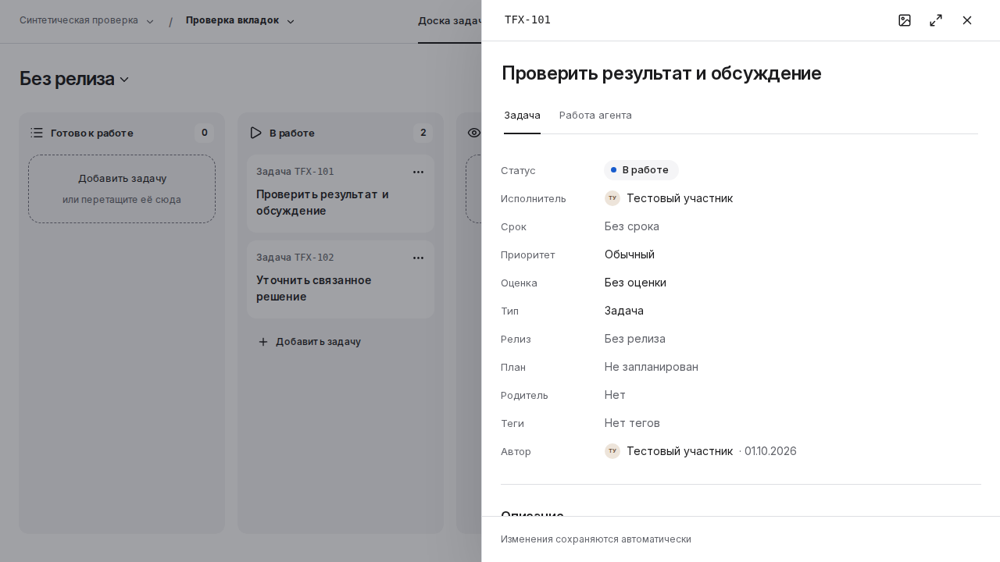

# Первый экран задачи: проблема, спор и сравнительный прототип

Дата: 12 октября 2026. Продолжение PF04 / WP04 принятого [исследования V3](https://github.com/it-novikov/iquipage-design-system/blob/4654517bdb94a629c19d514a194495348f08e25e/products/sprintique/docs/experience/research/sprintique_problem_first_research_plan_v3.md).

**Статус: baseline, первоначальный VT1 и Compact A отрендерены и независимо разобраны. Для следующей продуктовой проверки сохраняем Compact A; production и human acceptance ещё не получены.** Исходный аудит и две завершённые итерации ревью всего плана не повторяются.

Актуальный результат находится в [отчёте сравнительного прототипа](prototype/README.md). В обычной задаче первый абзац поднялся на 191 px и целиком попадает в исходный desktop viewport. В narrow case Compact A уменьшил сводку относительно первого VT1 на 96,78 px: срок и приоритет снова видны целиком, полный предмет и переход сохранены. Вход «Другие свойства» ещё частично срезан у footer. Дизайнер и независимый reviewer обсудили эту цену и сохранили вариант с явным ограничением.

[PR82](https://github.com/it-novikov/iquipage-design-system/pull/82) сохраняет frozen эксперимент. Общий run всё ещё FAILED из-за исходного поведения Estimate после Escape в обеих версиях; 14 initial frames сняты, четыре CTA engineering probes прошли. Исправление оценки вынесено в отдельный [PR83](https://github.com/it-novikov/iquipage-design-system/pull/83) со своим native PASS. Это не переименование старого failed run. Все попытки, correction и новые независимые споры находятся в [индексе прототипа](prototype/README.md#6-сохранённые-попытки-и-воспроизведение).

Ниже сохранён исходный problem-first разбор и направление первого сравнения. Его ожидания читаются вместе с новыми измерениями, а не как уже доказанные свойства production UI.

## Что необходимо решить

Человек открывает задачу, чтобы понять работу, продолжить её, проверить результат или изменить условия выполнения. Сейчас обычная задача сначала показывает 11 свойств. На исходном кадре 1280×720 содержимое описания не попадает в первый видимый экран, хотя название короткое, а многие свойства пустые. На 320×720 до описания не доходит даже его заголовок. Это наблюдение геометрии и иерархии; время поиска и ошибки людей пока неизвестны. [Пять исходных кадров](#исходные-кадры).

У задачи с работой агента причина другая. Сводка **уже существует перед свойствами**, но выражение `overview.text || overview.status` отдаёт единственную строку названию вопроса/шага. Для результата на проверке это название шага, а не сам результат. Поэтому одна перестановка свойств не закрывает обе проблемы. [Точный renderer](https://github.com/it-novikov/iquipage-design-system/blob/8f8d218168074bd4c7c9e1e29dfbe783a27998dd/products/sprintique/ui/src/board/task-work-view.js), [модель выбора](https://github.com/it-novikov/iquipage-design-system/blob/8f8d218168074bd4c7c9e1e29dfbe783a27998dd/products/sprintique/ui/src/board/work-model.js).

Причинная цепочка обычной задачи: один renderer создаёт 11 строк → публичный список свойств даёт каждой строке штатное место → свойства стоят перед описанием → важность содержания не выражается ни порядком, ни доступным местом. Дополнительные 8 px вкладок DS54 — измеренная цена исправленного focus; они не объясняют несколько сотен пикселей свойств. Уменьшение текста не решает этот приоритет и усугубит уже видимое усечение подписей при увеличенном тексте. [Task renderer](https://github.com/it-novikov/iquipage-design-system/blob/8f8d218168074bd4c7c9e1e29dfbe783a27998dd/products/sprintique/ui/src/board/task-dialog.js), [исходные стили](https://github.com/it-novikov/iquipage-design-system/blob/8f8d218168074bd4c7c9e1e29dfbe783a27998dd/products/sprintique/ui/src/board/board.css), [приёмка вкладок](../README.md#3-вкладки-проблема-причина-варианты-и-выбранное-решение).

## Предварительный выбор перед сравнением

Первый небольшой опыт — **сопоставимый baseline и VT1: устойчивое ядро свойств, явный вход в остальные, затем содержание**. Это приоритет следующей проверки, а не утверждение о предпочтениях пользователей.

| Порядок в задаче | Предлагаемая роль |
| --- | --- |
| Название, идентичность и существующие вкладки | Сразу понятно, какую работу человек открыл и где он находится |
| Существующая сводка работы и применимый личный запрос | В question/review явно различимы состояние, предмет и доступное действие; личный запрос не смешан с общей приёмкой |
| Статус, исполнитель, срок, приоритет | Прежние прямые контролы в стабильном порядке; сохраняются просрочка и смысловой сигнал важного приоритета |
| «Другие свойства» с видимой подсказкой об оценке, типе, релизе и плане | Понятный вход перед длинным описанием; внутри остальные семь строк, каждый контрол существует в одной копии |
| «Описание» и существующий Markdown | Читаемое содержание с обнаружимым редактированием и нынешним пустым состоянием |
| Материалы, связи, файлы, обсуждение | Существующие именованные секции и действия |

Группа остаётся открытой в течение текущей работы с задачей, в том числе при переключении вкладки или fullscreen. Переход к следующей задаче и повторное раскрытие имеют пользовательскую цену, которую нужно учитывать отдельно. Поля внутри не названы редкими: частота изменения оценки, типа, релиза и плана неизвестна. Нельзя заранее усреднить возможное ухудшение работы планировщика с улучшением чтения исполнителя.

Шрифт, контраст и плотность контролов сохраняются. Иерархию создают порядок, понятные подписи, выравнивание и интервалы публичной DS. Дополнительные декоративные карточки и повторные полосы действий не требуются. Первоначальная оценка выигрыша **205–207 px отозвана для уточнённого варианта**: подсказка, переносы и исправленная сводка меняют его высоту. Новые размеры измеряются только по actual render.

### Содержательные альтернативы

| Вариант | Что он помогает проверить | Пользовательская цена и условие пересмотра |
| --- | --- | --- |
| VT1: четыре свойства и раскрытие остальных | Можно ли приблизить описание, сохранив прямой доступ к ответственному/сроку и понятный путь к планировочным полям | Дополнительное раскрытие на разных задачах; вариант пересматривается, если поля не находят или частая правка заметно затрудняется |
| VT2: содержание рядом с полным открытым списком свойств | Нужны ли одновременно чтение и частая правка в действительно широком рабочем контексте | Существующий drawer 664 px не равен широкому редактору; fullscreen скрывает контекст доски. Сравнивать также с нынешним fullscreen baseline |
| C: содержание перед всеми открытыми свойствами | Достаточна ли простая смена порядка без disclosure | Длинное описание отдаляет даже исполнителя и срок; короткий пример не доказывает удобство длинной задачи |

VT2 и C остаются реальными альтернативами для разрешения конкретных возражений. Нет обязательного количества вариантов или кадров как отдельного gate. В узком режиме нельзя сохранять две колонки уменьшением текста или создавать вторые экземпляры полей.

## Какой результат показывать

Используется **ровно тот шаг, который существующий `workFocus` уже выбрал для review**. Selector выбирает первый подходящий шаг в порядке плана, а не последний по времени; открытый вопрос сохраняет более высокий приоритет. В этой работе не вводятся новая сущность результата Task и новый алгоритм внимания.

В existing summary достаточно одного компактного чтения: нейтральное состояние, название выбранного шага, буквальное начало его результата либо честное сообщение об отсутствии текста, с прежним переходом «Проверить результат». В первой пробе переход стоит перед preview, чтобы его место не зависело от длины фрагмента. Если текст сокращён, это видно по подписи «Начало результата» и явному переходу к полному содержимому. Нельзя выдавать заголовок за результат, сочинять пересказ или незаметно обрезать доказательство. Число символов — пробный бюджет для render, не контракт продукта.

Полное тело, evidence, критерии и разрешённые действия приёмки остаются в существующем review. Сводка не получает второй full `workStep` и кнопки принятия. Разрешённый просмотр, ответ и приёмка — разные полномочия.

| Реальное состояние | Выявленный риск | Уточнённая проекция для сравнения |
| --- | --- | --- |
| Открытый вопрос, ответ разрешён | Непустой title скрывает отдельный status | Вопрос и состояние различимы; прежнее разрешённое действие ответа |
| Открытый вопрос, ответ не разрешён | Существующий status всё равно говорит «Нужно ваше решение» | Нейтральное «Вопрос ждёт ответа» и прежнее «Открыть вопрос» |
| Выбранный review step с текстом результата | Нынешний overview содержит только название шага | Его же короткий буквальный result и путь к полному review |
| Тот же review step без текста результата | Нынешний overview выглядит так же, как при заполненном результате | Явное отсутствие текста; отсутствие текста не означает отсутствие evidence или результата вообще |
| Обычная задача без workPlan | Можно случайно создать пустую рамку или несуществующее следующее действие | Summary остаётся скрыт; основное содержание берётся из реального Markdown |

Reviewer отдельно проверил ветви `workFocus/workOverview` на таких входах; это исполнение модели, не UI-тест нового renderer. Есть ещё конкретная граница: для `step` fallback status описывает session, а не выбранный шаг. Завершённая session может соседствовать с отклонённым шагом. Поэтому первая правка отдельного статуса ограничена **question/review**; она не выводит session status во всех остальных ветвях.

## Как независимый спор изменил предложение

Это экспертный спор разных агентов GPT-6 Astra. Участники продукта не опрашивались. Reviewer сначала зафиксировал собственную позицию по коду и пяти кадрам, затем получил неизменяемый proposal дизайнера.

| Возражение | Почему оно существенно | Принятое уточнение |
| --- | --- | --- |
| Читателю результата мешает второй полный workStep после свойств | Повтор создаёт конкурирующие области и усложняет удержание актуального состояния | Один существующий summary с коротким конкретным result; полный review остаётся в своём месте |
| Удаление «Описание» меняет обнаружимость редактирования | Одновременная смена порядка и заголовка мешает объяснить эффект | Заголовок остаётся одинаковым с baseline; его удаление не входит в первый опыт |
| «Другие свойства» может не объяснить, где искать план и оценку | Дополнительная группа должна быть обнаружима без знания авторской классификации | Проверить явную подсказку о полях; не называть их редкими и не переносить старую оценку высоты |
| Read-only кадр не доказывает удобство редактирования | На картинке не видно выбора, сохранения, возврата фокуса и цены повторных раскрытий | Визуальное сравнение и интерактивный H11 имеют отдельные выводы |
| Показ всех status обнажает неверные значения для других ветвей | «Работа завершена» может оказаться рядом с шагом на доработке | Узкий question/review scope; selector и grants сохраняются |
| Постоянный набор вариантов и проверок раздувает следующий срез | Новая процедура начинает мешать разрешению конкретного вопроса | Сначала baseline/VT1; VT2/C подключаются по содержательному спору |

Исходники спора сохраняются отдельно и не переписываются задним числом:

- [Первоначальный proposal дизайнера](design-proposal.md), SHA256 `4a8a1862ec3684e81fb54e86da03304bd851cd8dd93e70220987a820de883aa5`.
- [Независимая позиция до прочтения proposal](review-initial-position.md), SHA256 `73b5d71043415cdd0c319e85a99fda41e1bdf117dbc2ee09e157f5d5413fe384`.
- [Независимый разбор и явные возражения](independent-review.md), SHA256 `a690c90b5a5af055510f4f243b224dd1c502b97060650814b7eb96294db73c5f`.
- [Ответ дизайнера и уточнённый первый срез](design-refinement.md), SHA256 `8118b3fc868153c9e68cc6080b6f3058b914ac3fe01cdfa2a534de55ccb171c3`.
- [Проверка технической осуществимости реального render](render-feasibility.md), SHA256 `e4810290b0a9ddd02e936468c5463d3be9a1f2d9f996b986846b944044e65f40`.

Их исходные абсолютные ссылки отражают рабочую среду исследования; переносимые ссылки на основные источники и кадры приведены в этом документе. Итоговое review и ответ дизайнера сохранены отдельными файлами, без изменения оригиналов. Быстрая сверка этого synthesis независимым reviewer не нашла искажения scope или ложного PASS; его уточнение о положении перехода перед preview применено.

## Исходный план сравнительного среза

1. Использовать frozen `8f8d218168074bd4c7c9e1e29dfbe783a27998dd` и публичный DS54. Сравнить исходную композицию с VT1 на одинаковых содержательных задачах. Не заменять реальные контролы похожей HTML-картинкой.
2. Для H01 дать обычную задачу и баг с понятным конкретным описанием; пустое содержание — отдельный случай, его цель не генерировать. Заголовок «Описание» и содержание baseline/варианта сохраняются одинаковыми.
3. Для H02 использовать настоящий shape выбранного done/unapproved step с result/evidence/criteria; отдельно вопрос с правом ответа и без него, пустой текст результата. Открытый вопрос не убирать из fixture молча ради выгодного review-кадра.
4. Для H11 проверить прежние поля, включая Оценку, Тип, Релиз и **План с отдельными start/end и «Применить»**. Type связан с шаблоном описания и default priority при создании; перенос поля не отменяет эти зависимости. Последовательность нескольких задач выявляет цену повторного раскрытия.
5. Создать итоговую экспериментальную композицию до mount контролов. Простое перемещение уже подключённых custom elements может вызвать disconnect/reconnect и cleanup. В production выбранный вариант сразу рендерит свой DOM; resize не перестраивает форму и не теряет draft.
6. Сравнивать title, доступность начала смысла, путь к нужному полю, читаемость текста, полные подписи, один scroll owner, footer и focus. Сопоставимые темы, узкая ширина, короткая высота и увеличенный текст нужны для конкретной применимости, а не как счётчик скриншотов.
7. Отдельно отметить create/readonly/accepted, обложку и personal request: текущие исходные кадры их не представляют. Перестановка shared renderer не считается принятой для этих случаев только по ordinary fixture.

Картинки отвечают на вопрос композиции. Модельные проверки отвечают на выбор состояния и данных. Synthetic frontend позволяет увидеть работу настоящих контролов, но не доказывает запись через реальный backend. Human H01/H02/H11 измеряются отдельными заданиями без подсказки; экспертное решение при отсутствии участников так и называется. Нет основания заявлять «стало быстрее» в процентах или human PASS по screenshots.

### Техническое решение для следующего прототипа

После feasibility назначена реализация в отдельной ветке `experiments/task-first-screen`, от frozen PR77. Сравнение использует точные временные patches трёх явно перечисленных продуктовых модулей **до первого mount**, отдельный static Vite build/preview на вариант и те же реальные публичные DS-контролы. Production source и старые PF03 fixtures остаются прежними; эксперимент не вводит runtime-переключатель в приложение.

В frozen feasibility ещё описано размещение рядом с product tests и manual-only запуск. Последующее решение root: хранить эксперимент в корневой `experiments/task-first-screen/`, а для native render использовать минимальный companion step существующего browser workflow и уже доказанный PR trigger. Причина — установленный отказ локального native Chromium без `/proc`; повторять его не нужно. Такое размещение также не запускает повторный полный backend CI только из-за добавления экспериментальных файлов. Обязательные gates продукта сохраняются; старый browser runner и его assertions не переписываются. Это конкретное уточнение способа запуска, а не новая платформа экспериментов.

Первоначальный checkpoint выше предшествовал реализации. Сейчас эксперимент опубликован, source reviews и actual evidence сохранены в [новом checkpoint](prototype/README.md). Пять исходных PNG ниже по-прежнему показывают прежний интерфейс и не переименованы в результат нового варианта.

Следующее действие агента — отдельный ограниченный production scope на актуальном main: учесть исправление Estimate, проверить затронутую работу с полями и состояниями, затем перенести принятую композицию. Не перезапускать исходное исследование, не ретаргетировать frozen PR82 автоматически и не объявлять Plan apply/busy/error принятыми по read-only adapter.

### Граница дизайн-системы

На исходном text200 кадре подписи «Исполнитель» и «Приоритет» уже усечены. Сначала проверить разрешённую настройку публичного property-list recipe. Если она не обеспечивает полные подписи и доступное значение в узком контейнере, нужен небольшой общий reflow contract в DS с readonly/editable примерами. Перестановка семи строк не исправляет оставшиеся четыре. Продукт не патчит внутренности select/date/editor и не уменьшает шрифт.

Группировка бизнес-свойств и `workFocus` принадлежат Sprintique. Для первого сравнения не доказана необходимость нового общего Task-компонента. У существующего `iq-work-layout` нет slots `aside`/`properties`; использовать несуществующий API вместо подходящего продуктового grid нельзя. [Публичный control contract](https://github.com/it-novikov/iquipage-design-system/blob/8f8d218168074bd4c7c9e1e29dfbe783a27998dd/libraries/iquipage/docs/control-contracts.md), [work layout](https://github.com/it-novikov/iquipage-design-system/blob/8f8d218168074bd4c7c9e1e29dfbe783a27998dd/libraries/iquipage/src/modules/work-layout.js).

## Исходные кадры

Все пять PNG лично просмотрены дизайнером и независимым reviewer. Они показывают уже существующий интерфейс после DS54, без альтернатив текущего предложения.

| Кадр | Viewport и предел вывода |
| --- | --- |
| [Desktop light](evidence/desktop-light-board-task-panel.png) | 1280×720; содержание описания ниже первого видимого экрана |
| [Desktop dark](evidence/desktop-dark-board-task-panel.png) | 1440×900; более высокая область позволяет видеть описание; не парный theme test предыдущего кадра |
| [Narrow light](evidence/narrow-light-board-task-panel.png) | 390×844; переносы title/автора, содержание низко |
| [Narrow dark](evidence/narrow-dark-board-task-panel.png) | 320×720; до описания первый экран не доходит |
| [Text200 light](evidence/text200-light-board-task-panel.png) | 768×900, root font-size 32 px; это увеличение корневого текста, не browser zoom |

Source: native run [38221220733](https://github.com/it-novikov/iquipage-design-system/actions/runs/38221220733), artifact `11734645359`, SHA256 ZIP `8b969d7f15bef33032c5b51d630ef75b9ac4385d7b10ff20df0e1568e0d20954`. Checkout `f53af728201b7a4ce2a128c6de7228143d2d50b4` имеет полный tree `a7bf8ed72f07d975a6837e8f1428382785893833`, совпадающий с frozen PR77 head. DS54 archive SHA256 `a726a4536e532fc556f615d0b1a9cda1873dc111e6090710329b9ec1b8204457`. Renderer: Chromium 151.0.7922.34, Playwright 1.62.1, Ubuntu 24.04, ru-RU/UTC, DPR 1. Синтетические adapters; backend/auth/persistence/human observation не входят в эти кадры. [Полный native raw, lossless gzip](../native/tabs/candidate/results.json.gz), [SHA256 сохранённых оригиналов](../preservation-manifest.json).

Численных лимитов PR нет. Полноценный onboarding остаётся отложенным до отдельного явного согласования владельца; реальные Safari/Firefox/iOS/VoiceOver относятся к проверке перед релизом.
