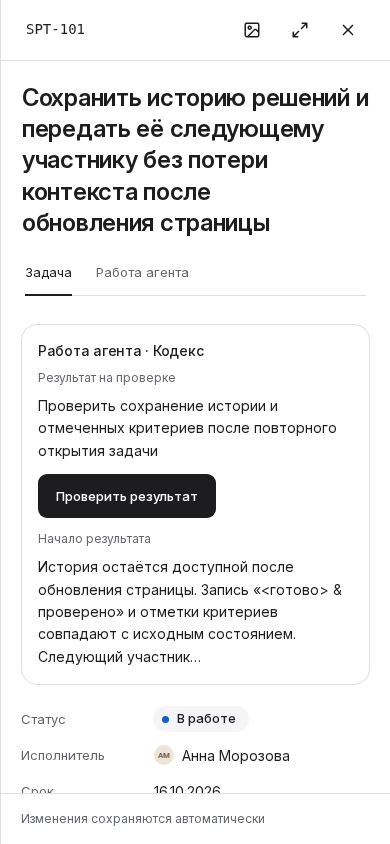
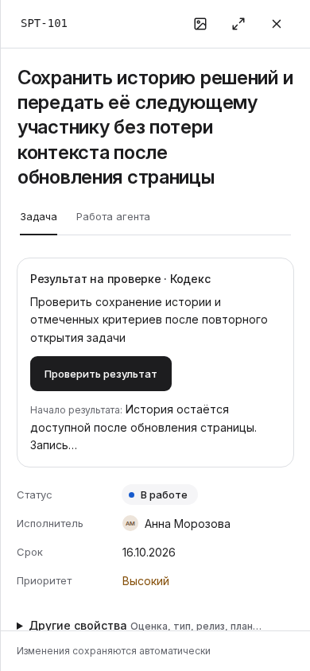

# Первый экран Task: что показало сравнение и почему выбран компактный вариант

## Решение

**Для дальнейшей продуктовой проверки сохраняем Compact A.** Обычная задача показывает содержание в первом экране; в задаче с результатом на проверке сводка объясняет состояние, предмет и доступное действие. На узком экране компактная сводка возвращает в поле зрения срок и приоритет, которые вытеснил первоначальный VT1. Это вывод из реальных кадров и независимого экспертного спора; время выполнения заданий людьми не измерено.

Вариант сохранён в [PR82](https://github.com/it-novikov/iquipage-design-system/pull/82). Он остаётся экспериментом на неизменяемой базе. Его runtime overlay не перенесён в production, а ветка не перенаправляется автоматически на новый main. [Независимый итоговый разбор](reviews/compact-native-R3/task-compact-native-review.md) и [решение после спора с дизайнером](reviews/compact-native-R3/task-compact-residual-designer-decision.md) сохранены отдельно от этого синтеза.

**Ограничение остаётся:** в узком случае с пятистрочным названием нижняя часть входа «Другие свойства» попадает под границу прокрутки. Это неудобство обнаружения семи полей. Его не объявляем исправленным, но и не используем как основание скрыть полный предмет работы, уменьшить шрифт или убрать полезное разделение блоков.

## 1. Две пользовательские проблемы и разные причины

Открыв обычную задачу, исполнитель хочет понять, что сделать и какой результат ожидается. Исходная композиция сначала показывает одиннадцать свойств, поэтому описание уходит за первый экран. Она отдаёт одинаковое место сведениям с разной ролью в текущем решении. Существующие поля полезны; причин считать оценку или план «редкими» нет. Проверяется другое: можно ли сохранить устойчивое ядро и понятный доступ к остальным свойствам, приблизив содержание.

Проверяющему результат нужна иная информация: что ждёт его внимания, какой шаг выбран, что получилось и где посмотреть полностью. Сводка работы агента уже находилась перед свойствами. Проблема в её проекции: одно место занимало название шага, а статус и реальный текст результата не объясняли происходящее одновременно. Одна перестановка полей этого не решала. [Исходная проблема и модель выбора](../README.md#что-необходимо-решить), [точный source overlay](https://github.com/it-novikov/iquipage-design-system/blob/ca99680799eee8c865038d537e1bef1def6478f0/experiments/task-first-screen/vt1-compact.patch).

В обоих случаях сначала определены нужное человеку решение и причина потери информации, затем рассмотрены варианты. Новые сущности результата, правила разрешений или алгоритм выбора внимания для удобной картинки не вводились.

## 2. Как устроена проверяемая композиция

| Область | Что человек видит и зачем |
| --- | --- |
| Идентичность, полное название, прежние вкладки | Можно проверить, какая задача открыта, и сохранить контекст |
| Одна существующая сводка question/review | Различимы состояние, полный предмет и прежний переход к вопросу или результату |
| Короткий буквальный результат выбранного шага | Есть конкретное содержание для первичной ориентации; полный review открывается прежним действием |
| Статус, исполнитель, срок, приоритет | Четыре прямых контрола остаются в постоянном порядке |
| «Другие свойства — Оценка, тип, релиз, план…» | Явный вход к остальным семи прежним полям; эти поля не исчезают и не дублируются |
| «Описание» и прежние секции | Заголовок сохраняет обнаружимость редактирования; Markdown, материалы и обсуждение не подменяются вымышленным содержанием |

При открытом вопросе приоритет остаётся у вопроса. Для роли без права ответа надпись стала нейтральной: «Вопрос ждёт ответа», с разрешённым «Открыть вопрос». Отсутствие текста результата обозначается как отсутствие **описания результата**, а не как отсутствие результата или evidence вообще. Полная приёмка и её разрешения остаются в существующем review.

Имя агента в сводке берётся из текущего session context. Оно **не доказывает авторство выбранного результата**. Этот риск прочтения сохраняется при дальнейшем проектировании; нельзя представлять соседство имени и статуса как новую связь данных. [Source review compact](reviews/compact-source-R2/task-compact-source-review.md).

Эксперимент сохраняет шрифты и публичные контролы DS54. Композиция создаётся до первого mount; нет перемещения уже подключённых custom elements, клонирования контролов или исправления scroll/focus после кадра. Ветка создания новой задачи явно сохраняет исходную компоновку; полноценная приёмка create этим не заменяется.

## 3. Что изменилось после реального render

Сравнение содержит семь пар: обычная задача H01, результат на проверке H02, узкий длинный случай в light/dark, увеличенный корневой текст, пустой текст результата и вопрос без права ответа. Данные в каждой паре одинаковы. Все первые кадры сняты при нулевой прокрутке тела задачи, до интерактивных проб. Отдельные счётчики CAPTURED, engineering probes и human acceptance не смешиваются.

| Ситуация | Измеренный результат | Пользовательский смысл и предел |
| --- | --- | --- |
| Обычная H01, 1280×720 | Первый абзац: y721,98 → y530,98, на 191 px выше; в кандидате все 49 px блока видны | Конкретная цель появляется в первом экране; человеческое время чтения не измерено |
| H02, 1280×720 | Сводка: первый VT1 170,38 px → Compact 118,38 px | Полный предмет, буквальный результат и переход сохранены; заголовок описания виден, первый абзац ещё ниже области чтения |
| Длинный narrow, 390×844 | Сводка 360,72 → 263,94 px, экономия 96,78 px | Срок и приоритет теперь целиком видны, включая текст; полное имя шага и CTA сохранены |
| Тот же narrow | У disclosure видно 28,625 из 45 px; текстовые rects заходят за край на 2,375 px | Вход к семи полям частично срезан; нельзя объявлять его полностью видимым |
| Empty H02 | Сводка 139,98 → 113,98 px | Отсутствие описания результата выражено честно. Пересечение блока абзаца с viewport на 0,031 px не делает его текст читаемым |
| Вопрос без права ответа | Сводка 109,98 → 83,98 px; первый абзац виден целиком | Нейтральный статус не требует недоступного действия; путь к вопросу сохранён |
| Root text200, ordinary H01 | Первый абзац 779,78 → 591,78 px; видны 51,22 из 147 px | Содержание приблизилось, но подписи/значения свойств всё ещё усечены. Review summary при увеличенном тексте этот кадр не представляет |

Метрики относятся к конкретным данным и размерам, а не к обещанию одинакового выигрыша во всех задачах. Для narrow первый абзац тоже поднялся — с y1058,39 до y938,56 — и всё равно остаётся за первым экраном. [Полные данные и источники compact](compact-attempt-1/README.md), [предыдущий VT1](attempt-2/README.md).

| Первый VT1: сводка вытесняет важные свойства | Compact A: срок и приоритет возвращаются |
| --- | --- |
|  |  |

Семь baseline PNG в compact run побайтно равны предыдущему run. H01 и text200 compact также не изменились относительно первого VT1. Поэтому повторный просмотр не выдаётся за новое независимое подтверждение: reviewer лично изучил пять изменившихся кадров, а остальные связал точными SHA с прежней проверкой.

## 4. Спор об эстетике, полноте и цене действий

После первого actual VT1 возник содержательный конфликт: подробная сводка помогает проверяющему, но отодвигает срок и приоритет исполнителя. Compact A сократил уровни представления: состояние и прежний контекст находятся в одной строке с переносом; подпись результата включена в его текст; буквальный фрагмент имеет пробный бюджет 64 code points. Полный предмет и прежняя CTA сохранены. Это не новый публичный DS контракт на длину текста и не гарантия количества строк.

Независимый reviewer сначала зафиксировал собственную позицию по новым кадрам, а затем обсудил её с автором. В споре рассмотрены интересы проверяющего результат, исполнителя, человека, который часто меняет оценку/план, и требования композиционной ясности. Это роли экспертного разбора разных агентов GPT-6 Astra; реальные участники исследования не опрашивались.

| Вопрос и позиция | Возражение с другой стороны | Итог |
| --- | --- | --- |
| Срез входа ограничивает обнаружимость; допустим ещё один вариант без рамки | Для планировщика основная цена — раскрытие и прокрутка к самим полям. Возврат последних 16,375 px почти не уменьшает эту работу; рамка помогает отделить review от свойств | Reviewer изменил позицию: дефект фиксируется как ограничение stress-case, отдельный обязательный restyle не нужен |
| Последняя строка «Запись…» выглядит оборванно | Простая замена 64 на другое число подгоняет fixture; предпочтение конца предложения может оставить лишь «Нет.» из «Нет. Причина…» | Сохраняется честно обозначенный буквальный фрагмент; альтернативное правило остаётся гипотезой для других текстов |
| Наиболее компактная картинка эстетичнее | Снятие штатного класса меняет и padding, и gap, и доступную ширину. Экономия не доказана вычитанием одного отступа; может потеряться разделение | Нужен самостоятельный пользовательский выигрыш, чтобы оправдать новый render; его для plain frame сейчас не найдено |
| Можно выбрать глобальный двухколоночный вариант или вынести описание перед всеми свойствами | Ширина drawer и длинное описание создают другие потери; эти варианты не решают доказанную причину автоматически | VT2/C остаются адресными альтернативами, не обязательным количеством вариантов |

Итог — сохранить рамку, полный title/subject, прежнее действие и текущее правило фрагмента. Нет «идеального числа пикселей», которое каждый экран обязан вместить. Но видимые обрезания не исчезают из отчёта из-за общего положительного решения. [Исходная независимая позиция](reviews/compact-native-R3/task-compact-native-review-initial-position.md), [позиция дизайнера](reviews/compact-native-R3/task-compact-residual-designer-position.md), [итоговый независимый спор](reviews/compact-native-R3/task-compact-native-review.md).

## 5. Почему общий browser run всё ещё FAILED

Все 14 initial frames сняты. Четыре отдельные пробы перехода к существующему review/вопросу прошли инженерные проверки. Две пробы доступа к свойствам в baseline и кандидате остановились на **общей исходной ошибке оценки после Escape**. Визуальный выигрыш не переводит этот run в PASS.

Первый опыт вообще не открыл нужную задачу: selector совпал со скрытой ссылкой Epic. Следующий selector стал строго указывать видимую собственную кнопку Task. Во втором опыте четыре CTA-пробы упёрлись в слишком общий selector выбранного элемента; он уточнён до нужного tablist, без `.first()`, `force` или ослабления результата. Эти ошибки harness отделены от продукта, а их исходные failed данные сохранены.

Интерпретация ошибки оценки также исправлена явно: wait открытия прошёл; отказ произошёл в следующем ожидании закрытия после Escape. Popup был открыт под BODY вне modal, input не имел actual focus, после Escape Task исчезал, а popup оставался. Passive trace не записывал keydown/cancel dispatch. Точный обработчик закрытия уточняется source review, в том числе собственным capture-handler Task. [Отозванная ранняя трактовка и correction](reviews/README.md), [attempt3 trace](attempt-3/README.md).

Это породило отдельное конкретное исправление [PR83](https://github.com/it-novikov/iquipage-design-system/pull/83) на текущем main. Его собственные 10 native случаев прошли в [run38238395802](https://github.com/it-novikov/iquipage-design-system/actions/runs/38238395802), [новые первичные данные](../../native/estimate/README.md). Этот PASS относится к другому точному кандидату: он не меняет старый FAILED PR82 задним числом и не доказывает весь H11 Plan workflow.

## 6. Сохранённые попытки и воспроизведение

| Пакет | Exact head | Честный итог |
| --- | --- | --- |
| [Attempt1](attempt-1/README.md) | `a82960df22cd93dfa8dcbdda618e3169cbcda068` | Failed open locator; снимки Board не принимаются за Task |
| [Attempt2](attempt-2/README.md) | `0c74ab69487fa5d7ec66ead92400043901e85af2` | 14 initial frames; 6 failed probes, причины разделены |
| [Attempt3](attempt-3/README.md) | `2f66973538605035bf354ed264ee0c95f2a34ec5` | 14 initial, 4 CTA passed, 2 Estimate after-Escape failed; passive trace сохранён |
| [Compact attempt1](compact-attempt-1/README.md) | `ca99680799eee8c865038d537e1bef1def6478f0` | 14 initial, 4 CTA passed, те же 2 Estimate failed; независимый визуальный разбор сохранил кандидата с оговорённым ограничением |

У каждого пакета сохранены реальные PNG, полный lossless raw, журнал, ZIP inventory, размеры/SHA и связь checkout → head tree. Равенство проверено по всему дереву, а не только по имени ветки. Environment: GitHub Actions Ubuntu 24.04, Node24.20, Vite8.3, Playwright1.62.1, Chromium151.0.7922.34, ru-RU/UTC, DPR1. Точный опубликованный DS54 tar и 176 установленных файлов совпали побайтно. Компиляция использует реальные Task/Board и публичные DS controls с явно синтетическим read adapter.

Агенту для воспроизведения нужен exact head и [runner/plan](https://github.com/it-novikov/iquipage-design-system/tree/ca99680799eee8c865038d537e1bef1def6478f0/experiments/task-first-screen). `--plan original` и `--plan compact` выбирают сохранённые варианты. Локальный build-only не считается browser PASS. Известный отказ native Chromium в ограниченной среде не следует повторять без изменения этой среды.

## 7. Следующий продуктовый срез

Перенос Compact A требует отдельного кандидата от актуального main с принятым исправлением оценки. Его задача — проверить реальную работу с теми полями и состояниями, которые меняет перенос, и затем внести минимальную продуктовую композицию. Frozen эксперимент сохраняет исходную базу как доказательство сравнения.

Главная неразрешённая задача планировщика — найти оценку/тип/релиз/план и выполнить правку, в том числе на следующей задаче. Текущий read adapter не доказывает применение start/end, busy/error и сохранение draft. Открытие popup не равняется сохранению данных. Create, readonly/accepted, cover и personal request тоже нельзя считать принятыми по обычному editable fixture. Нужный объём проверки выбирается по затронутому поведению, без новой квоты вариантов или обязательного повторения всех сценариев на каждую правку.

Отдельная причина дефектов остаётся в property-list при увеличенном тексте: усечённые label/value требуют проверки публичного reflow contract DS. Ни группировка семи строк, ни исправление popup этого не решают. Общие закономерности и безопасные defaults должны попадать в DS, а бизнес-порядок свойств и выбор `workFocus` остаются Sprintique.

Human H01/H02/H11, backend persistence, реальные browser zoom/Safari/Firefox/iOS/VoiceOver и производительность не получили PASS от этих снимков. Релизные платформы проверяются перед релизом; полноценный onboarding остаётся отложенным до отдельного явного согласования. Число PR не ограничивает продолжение работы.
