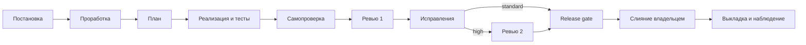

# Рабочий процесс поставки

Статус: **обязательный**
Цель: выпускать самое простое решение, которое полностью закрывает подтверждённые требования, и тратить на проверку столько усилий, сколько стоит риск ошибки.

## 1. Роли

| Роль | Кто | Отвечает за |
|---|---|---|
| Владелец | Человек | Проблему, рамки, приёмку, слияние и выкладку |
| Автор | Человек или агент | Решение, тесты, документацию, карточку задачи |
| Ревьюер | Не автор. Для агентов — другая сессия, по возможности другая модель | Независимую проверку |

Агент не сливает PR, не включает автослияние, не публикует и не выкладывает без явного разрешения владельца в этой задаче.

## 2. Уровень риска

Уровень определяется при постановке и записывается в карточку (`risk:`). Он задаёт глубину всех следующих шагов. Если в ходе работы риск вырос, уровень повышается, понижать его без владельца нельзя.

| Уровень | Признаки | Примеры |
|---|---|---|
| **low** | Нет изменения поведения для пользователя или API | опечатка, документация без новых обещаний, форматирование, патч-версия зависимости при зелёном CI |
| **standard** | Поведение меняется внутри одного модуля, контракт, схема и права не меняются | новое поле в форме, исправление ошибки в сценарии, новый экран на готовом API, минорная версия зависимости |
| **high** | Хотя бы одно: публичный API или контракт; миграция схемы или данных; аутентификация, права, RLS, секреты; удаление данных; новая технология, новая зависимость или мажорная версия; внешняя интеграция; граница модулей; горячий путь производительности; необратимое действие | новый эндпоинт, миграция, смена стека, изменение формата сессии |

Изменение миграций, политик доступа и OpenAPI автоматически означает **high**: `bridge check` сверяет уровень карточки с изменёнными файлами по правилам `riskFloor` в `.bridge/config.json` и не даёт занизить его.

## 3. Что требуется на каждом уровне

| Шаг | low | standard | high |
|---|---|---|---|
| Карточка задачи в мосте | не нужна, достаточно описания коммита | цель, рамки, план с приёмкой | полная, с проработкой |
| Проработка (раздел 4.2) | — | коротко, в плане | чек-лист полностью, «неприменимо» допустимо с причиной |
| ADR | — | если меняется правило системы | при изменении контракта, схемы, технологии, границ |
| Тесты | существующие проходят | новые на изменённое поведение | плюс сценарии безопасности, конкурентности и отката |
| Ревью | самопроверка diff | одно независимое | два независимых, второе — на исправленный результат |
| Rollout / rollback | — | — | план и проверка отката миграции |
| Наблюдение после выкладки | — | health и ключевой сценарий | окно наблюдения и условие отката заранее |

## 4. Поток задачи

У каждого шага есть условие выхода. Шаг не считается пройденным, пока условие не выполнено.

### 4.1. Постановка

Автор заводит карточку: `bridge new <slug> --title "…"`. В ней:

- **Цель:** какая проблема у кого и какой результат.
- **Рамки:** что входит, что явно не входит, ограничения.
- **Приёмка:** проверяемые критерии задачи (`A1`, `A2`, …) — то, против чего проверяют ревью и release gate.
- **Уровень риска.**

Выход: владелец подтвердил рамки. Для standard достаточно того, что задачу поставил владелец. Для high нужно явное подтверждение.

### 4.2. Проработка (high)

До кода отвечаем на вопросы. На каждый — ответ или «неприменимо, потому что…»:

1. Основные сценарии, роли и пограничные случаи.
2. Правила данных, доступа, приватности.
3. Ошибки, конкурентные изменения, повторы запросов.
4. Лимиты ввода, пагинация, ожидаемая нагрузка.
5. Зависимости и деградация при их отказе.
6. Миграция, обратная совместимость, откат.
7. Рассмотренные альтернативы и почему выбран самый простой достаточный вариант.

Выход: ответы записаны в карточку или ADR, открытых вопросов к владельцу нет.

### 4.3. План

Шаги в карточке. У каждого есть **Что**, **Как**, **Зачем** и **Приёмка** (проверяемые критерии). Шаг помещается в одну рабочую сессию агента. Если не помещается, делится.

Выход: каждый критерий приёмки задачи покрыт хотя бы одним шагом (поле «Покрывает»); `bridge check` это проверяет.

### 4.4. Реализация

- Отдельная ветка `<type>/<description>`, небольшие логические коммиты.
- Код, миграции, тесты, конфигурация и документация меняются вместе.
- После каждого шага: тесты шага зелёные, критерии отмечены, контрольная точка в карточке (`bridge checkpoint`).
- Будущие сценарии записываются как точки расширения, но не реализуются.

### 4.5. Самопроверка

Автор перед запросом ревью:

1. Запускает все автоматические проверки уровня и прикладывает результат к шагу.
2. Читает свой diff целиком по [чек-листу ревью](review.md#чек-лист) и исправляет найденное.
3. Сверяет, что документация не обещает нереализованного.

Выход: всё зелёное, в карточке раздел «Передача» готов для ревьюера.

### 4.6. Ревью

Ревьюер получает не историю чата, а **пакет ревью**: карточку (цель, рамки, критерии), diff и доказательства проверок. Это делает ревью дешёвым и независимым. Правила — в [review.md](review.md).

- **Ревью 1** проверяет весь diff. Для high его можно разделить между двумя ревьюерами, работающими параллельно по разным аспектам: безопасность и данные, корректность и простота.
- **Ревью 2** (high) проводит другой ревьюер с чистым контекстом: `bridge review --since R1` даёт ему замечания первого раунда и только изменения после него. Исправления и их окрестность проверяются полностью, остальное — выборочно. Фокус: побочные эффекты исправлений, простота итогового решения, полнота тестов, расхождения между кодом, базой, OpenAPI и документацией.

Замечания P0 и P1 исправляются до продолжения; исключения — по правилам [ревью](review.md#формат-замечания). P2 исправляется или переносится в отдельную задачу с причиной. P3 — на усмотрение автора. После исправлений автоматические проверки повторяются.

### 4.7. Release gate

Задача готова, когда:

- все критерии приёмки выполнены, а «не входит» не попало в реализацию;
- все проверки уровня зелёные, пропущенные названы;
- OpenAPI совпадает с поведением, документация актуальна;
- миграция применена с нуля и откат проверен (high);
- ревью завершены, P0/P1 закрыты;
- секретов нет в коде, diff, логах и карточке;
- известные ограничения и условия пересмотра записаны.

Выход: для standard и high — карточка в статусе `review` с итогом по каждому шагу и отмеченными критериями, PR открыт; для low — PR с результатом проверок. Сливает владелец.

### 4.8. Выкладка и наблюдение

Только при явной цели выкладки и разрешении владельца. После выкладки: health, ключевой сценарий, ошибки, задержки, пул соединений, логи. Для high окно наблюдения и условие отката определяются заранее.

## 5. Правила потока

- **Одна задача — одна ветка — один worktree — один держатель.** Параллельная работа — отдельные карточки. Общие файлы, которые правят многие (миграции, lock-файлы, общие настройки), меняются отдельной задачей, а не в двух ветках сразу.
- **Ветка от main, если работа не зависит от незалитого кода.** Стек PR — только когда изменение действительно опирается на нижний PR.
- **Стек PR не глубже трёх.** Длинный стек копит конфликты и откладывает ревью. Если стек уже глубже, новый уровень не начинается, пока владелец не сольёт нижний.
- **Лимит у владельца.** Не больше трёх несмерженных PR и трёх задач в `review` на владельца. Пока лимит занят, агенты берут только исправления и ревью, а не новые задачи.
- **Эскалации.**
  - Вопрос без ответа больше суток мост напоминает при каждом старте сессии.
  - Две сессии эстафеты подряд без продвижения переводят задачу в `blocked` с причиной.
  - Отклонённое автором замечание P0/P1 (`[rejected]`) решает владелец: `[waived …]` или исправление. Пока он не решил, задача не закрывается.
  - P1 можно перенести (`[deferred …]`), только если оно касается артефакта вне изменения, а целевая задача входит в тот же выпуск. P0 не переносится.
- **Остановить линию.** Найденная P0 останавливает текущую работу автора до исправления.
- **Готовность к передаче.** Карточка всегда описывает текущее состояние. Работа, записанная только в чате, считается несделанной.
- **Модель по задаче.** Сильная модель — для проработки, архитектуры и ревью. Более дешёвая — для механических шагов: переименований, тиражирования по образцу, сбора доказательств. Шаг помечается `Модель: fast`, и эстафета отдаёт его агенту с `"model": "fast"` из `.bridge/config.json`.
- **Автослияние.** По умолчанию запрещено. Владелец может заранее и явно разрешить его для `low` с зелёным CI в конкретном репозитории. Агент сам его не включает.

## 6. Обратная связь

Каждое замечание P0/P1 из ревью — вопрос к системе: могла ли его поймать автоматика? Если да, добавляем проверку. Если замечание повторяется, дополняем чек-лист ревью или правило.

`bridge stats` считает по журналам и отчётам ревью:

- время цикла по уровням риска;
- число раундов ревью;
- P0/P1 на задачу;
- передачи по причинам.

Раз в месяц владелец смотрит четыре цели:

1. Медиана цикла `standard` не растёт.
2. У `standard` — не больше одного раунда ревью.
3. P0/P1, найденные после слияния, не растут. Их меньше, чем найденных на ревью.
4. Передачи по `limit` и `error` не требуют ручного вмешательства дольше часа.

После крупной функции проводится короткая сверка архитектуры и документов. Когда есть production, раз в месяц смотрим ошибки, задержки, ресурсы, медленный SQL, зависимости и технический долг. Отчёты — в `docs/health/` проекта, у каждого действия есть владелец, срок и измеримый признак завершения.
